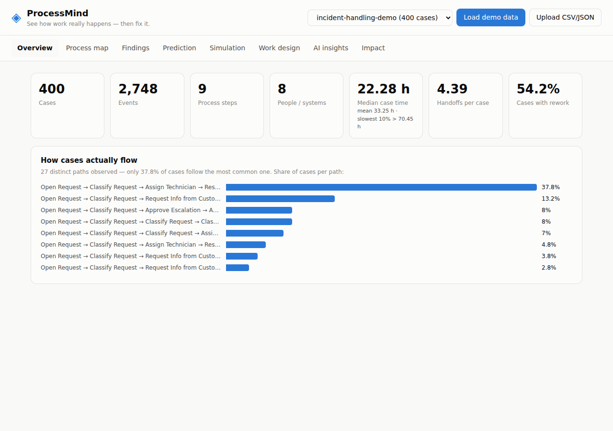
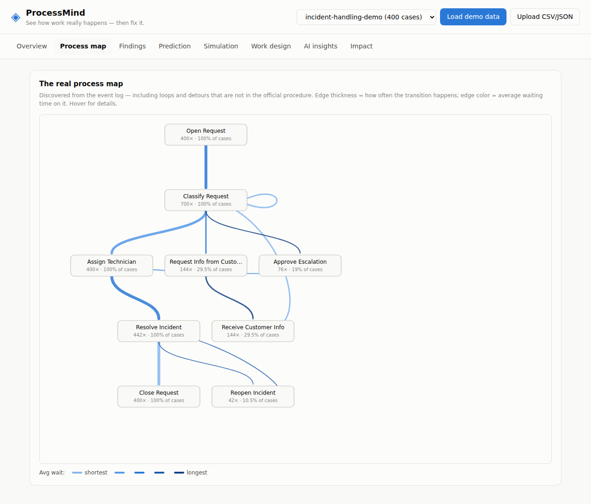
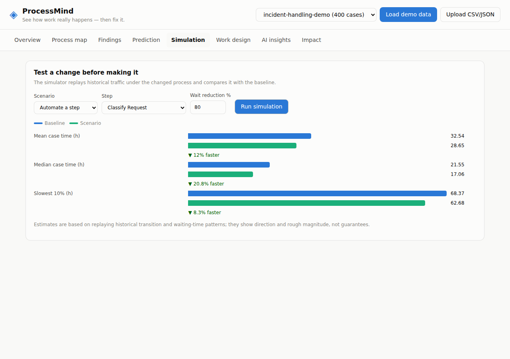
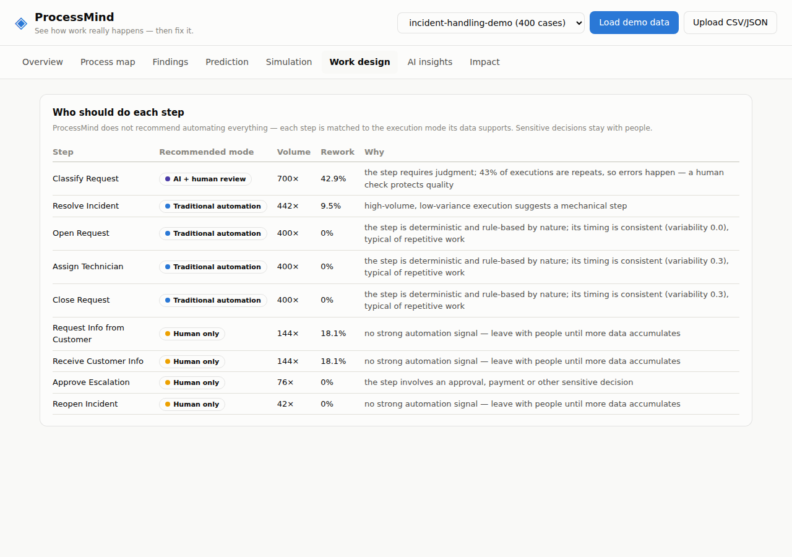

# ProcessMind

**An AI-powered process intelligence platform — discover how work *actually* happens, find what's broken, simulate the fix, and design the right division of labor between humans, software, and AI.**


---

## Why ProcessMind

Every organization has an official procedure: *open a request → assign it → close it*. Reality is different — requests bounce between departments, wait for a single approver, loop back to the customer for missing information, and quietly consume days of cycle time that no flowchart accounts for.

Traditional process-mining tools show you diagrams and leave the interpretation to you. Traditional automation tools skip the diagnosis entirely and make a broken process run faster. **ProcessMind does neither**: it reconstructs the real process from your event data, explains its problems in plain language with the numbers to back every claim, lets you test improvements in simulation *before* you commit to them, and only then recommends what to automate — and critically, what **not** to.

```
                 ┌─────────────────────────────────────────────────────────┐
                 │                      ProcessMind                        │
                 │                                                         │
  Event data     │  Discover ──▶ Analyze ──▶ Predict ──▶ Simulate          │      Decisions
  (tickets,   ──▶│     │            │           │            │             │──▶  you can
  tasks, logs)   │     └────────────┴─────┬─────┴────────────┘             │      defend
                 │                        ▼                                │
                 │        Explain (AI narrative) ──▶ Design work ──▶ Measure│
                 └─────────────────────────────────────────────────────────┘
```

## Core capabilities

| Capability | What it means in practice |
|---|---|
| **Process discovery** | Reconstructs the real workflow from raw events — every path, loop, and detour, with frequencies and waiting times. On the bundled demo, the "official" 5-step procedure covers only ~38% of real cases. |
| **Evidence-backed analysis** | Finds bottlenecks, rework loops, ping-pong handoffs, single-person dependencies, and case attributes that drive delays. Every finding ships with the numbers that justify it — *"48.5% of cases loop back to Classify Request, adding 1.5h each time"* — never a generic recommendation. |
| **Delay prediction** | A transparent logistic model learns which case characteristics predict delays (91% accuracy on the demo), so risky cases can be flagged the day they're opened. Every model weight is inspectable — no black box. |
| **What-if simulation** | Monte Carlo replay of historical traffic under a proposed change: remove a step, automate it, add capacity, or reassign it. Get the estimated cycle-time impact *before* touching the real process. |
| **Human/AI work design** | Classifies every process step into one of four execution modes — traditional automation, AI with human review, low-risk autonomous AI, or human-only — with data-driven rationale. Approvals, payments, and other sensitive decisions are **always** kept human, regardless of what the statistics say. |
| **Plain-language insights** | A consultant-grade narrative generated by Claude (`claude-opus-4-8`) from the structured analysis — with a fully deterministic offline fallback, so the product works without any API credentials. |
| **Impact measurement** | Before/after comparison at any change date: did handling time, handoffs, rework, and throughput actually improve? Outcomes accumulate in a knowledge base so the system learns which change types work. |

## Screenshots

**Overview** — stat tiles + how many distinct paths the process really runs in:



**Process map** — the discovered flow, loops included. Edge width = frequency, edge color = waiting time, hover for details:



**Simulation** — baseline vs. scenario, estimated before any real change is made:



**Work design** — who should do each step, with the data-driven rationale:



## Quick start

Requires **Python 3.12+**. No database, no external services.

```bash
git clone https://github.com/GalAshkenazi20/ProcessMind.git && cd ProcessMind
python3 -m venv .venv
.venv/bin/pip install -r requirements.txt
.venv/bin/python run.py
```

Open **http://127.0.0.1:8000**, click **Load demo data**, and walk the tabs:

**Overview → Process map → Findings → Prediction → Simulation → Work design → AI insights → Impact**

The demo is a synthetic 400-case incident-handling process with realistic pathologies baked in (a missing-information rework loop, a single approver bottleneck, ping-ponging classification work, and a mid-timeline "fix" so the impact comparison has something to show).

### Enabling AI narratives (optional)

The **AI insights** tab calls the Claude API when credentials resolve:

```bash
export ANTHROPIC_API_KEY=sk-ant-...   # or authenticate via `ant auth login`
.venv/bin/python run.py
```

Without credentials, the same narrative structure is generated deterministically from the analysis data — nothing breaks offline. The AI path sends **aggregated analysis results only**, never raw events.

## Bring your own data

Upload a CSV or JSON export where **each row is one event**:

```csv
case_id,activity,timestamp,resource,priority,channel
INC-1001,Open Request,2026-01-05T09:14:00,Avi,high,portal
INC-1001,Classify Request,2026-01-05T10:02:00,Noa,high,portal
INC-1001,Resolve Incident,2026-01-06T08:40:00,Dana,high,portal
```

| Field | Required | Notes |
|---|---|---|
| Case ID | ✅ | Aliases auto-detected: `case_id`, `ticket_id`, `incident_id`, `order_id`, `claim_id`, … |
| Activity | ✅ | Aliases: `activity`, `action`, `status`, `step`, `task`, … |
| Timestamp | ✅ | ISO 8601 and common formats parsed automatically |
| Resource | ⭕ | Who/what performed the event — powers handoff and dependency analysis |
| Extra columns | ⭕ | Become case attributes — power the delay-driver analysis and the risk model |

A ready-made sample lives at [`data/sample_events.csv`](data/sample_events.csv). JSON is accepted as a flat array of event objects or `{"events": [...]}`.

## Architecture

```
ProcessMind/
├── run.py                    # server entry point
├── processmind/
│   ├── schema.py             # unified data model: Event → Case → EventLog
│   ├── ingest.py             # CSV/JSON adapters, column auto-detection, timestamp parsing
│   ├── discovery.py          # directly-follows graph, variants, activity statistics
│   ├── analysis.py           # findings engine (bottlenecks, rework, ping-pong, key-person risk, delay drivers)
│   ├── prediction.py         # delay-risk logistic model (pure Python, fully inspectable)
│   ├── simulation.py         # Monte Carlo what-if engine fitted to historical transitions
│   ├── automation.py         # human/AI/automation work-design classifier
│   ├── insights.py           # Claude narrative + deterministic fallback
│   ├── impact.py             # before/after comparison + knowledge base
│   ├── sample_data.py        # synthetic demo log generator
│   └── api.py                # FastAPI application (REST + static serving)
├── static/                   # zero-dependency dashboard (vanilla JS, light/dark, CVD-safe palette)
├── tests/                    # end-to-end test suite
└── data/                     # sample CSV + persisted knowledge base
```

**Design principles:**

- **Standard library first.** The mining, analysis, prediction, and simulation engines have zero heavy dependencies — no pandas, no scikit-learn. The full dependency list is FastAPI, uvicorn, and the (optional at runtime) `anthropic` SDK.
- **Evidence or it didn't happen.** Every finding, recommendation, and narrative sentence traces back to computed numbers. The AI layer is constrained to restate figures from the analysis — it never invents them.
- **Graceful degradation.** No API key → deterministic narratives. Unknown columns → auto-detection with explicit errors. Invalid scenarios → actionable 400s listing valid activities.
- **Diagnose before automating.** The work-design classifier runs *after* the problem analysis, and risky steps (approvals, payments, legal) are pinned to `human_only` by keyword guard regardless of their statistics.

## HTTP API

Interactive OpenAPI docs at `/docs`.

| Endpoint | Method | Purpose |
|---|---|---|
| `/api/demo` | POST | Load the synthetic demo dataset |
| `/api/upload` | POST | Upload a CSV/JSON event log (multipart) |
| `/api/datasets` | GET | List loaded datasets with summaries |
| `/api/overview?dataset=` | GET | Summary statistics + variant analysis |
| `/api/process-map?dataset=` | GET | Directly-follows graph (nodes, edges, waits) |
| `/api/findings?dataset=` | GET | Severity-ranked, evidence-backed findings |
| `/api/predictions?dataset=` | GET | Model metrics, risk factors, highest-risk cases |
| `/api/work-design?dataset=` | GET | Per-step execution-mode recommendations |
| `/api/simulate` | POST | Run a what-if scenario (see below) |
| `/api/insights?dataset=` | GET | Plain-language narrative (`mode: ai \| fallback`) |
| `/api/impact` | POST | Before/after comparison at a split date |
| `/api/knowledge` | GET | Recorded outcomes + effectiveness by change type |

**Simulation request:**

```json
POST /api/simulate
{
  "dataset": "incident-handling-demo",
  "type": "automate_activity",        // remove_activity | add_capacity | reassign_activity
  "activity": "Approve Escalation",
  "reduction_pct": 90
}
```

**Response** (paired Monte Carlo comparison, 2,000 replications with a shared random stream):

```json
{
  "results": {
    "mean_duration_hours":   { "baseline": 32.5, "scenario": 29.3, "change_pct": -10.0 },
    "median_duration_hours": { "baseline": 21.6, "scenario": 17.1, "change_pct": -20.8 },
    "p90_duration_hours":    { "baseline": 68.4, "scenario": 62.7, "change_pct": -8.3 }
  }
}
```

## Testing

```bash
.venv/bin/python -m pytest tests/ -q
```

The suite covers the full pipeline end-to-end: ingestion round-trips, discovery correctness, detection of every pathology planted in the demo data (the rework loop, the single approver, the delay-driver attribute), prediction accuracy floors, simulation directionality, work-design mode assignments (including keyword-guard edge cases), impact verdicts, and the complete HTTP API flow including error paths.

## Privacy & safety

- **Read-only by design.** ProcessMind analyzes, explains, predicts, and simulates. It never writes to source systems, and no change is executed without a human acting on it.
- **Local data.** Datasets live in server memory; the only file persisted is the local knowledge base (`data/knowledge.json`). Nothing is uploaded anywhere.
- **Minimal AI exposure.** The optional Claude call receives aggregated statistics and findings — not raw events, not personal records.
- **Human accountability preserved.** Sensitive decision steps are structurally excluded from automation recommendations.

## Roadmap

- [ ] Persistent dataset storage (SQLite) and multi-user workspaces
- [ ] Role-based access control and PII masking on ingest
- [ ] Live connectors (Jira / ServiceNow / Zendesk webhooks) alongside file upload
- [ ] Concurrency-aware simulation (resource calendars, queue disciplines)
- [ ] Cross-organization pattern library learned from the knowledge base
- [ ] Approval-gated automation hooks: execute a recommended change through an integration, only after explicit sign-off

## License

MIT

---

*ProcessMind functions as a digital operational consultant: it shows how work is actually performed, identifies where time and resources leak, proposes data-based fixes, and lets you test them before they touch production. The goal is not to replace people — it's to divide work well between people, software, and AI.*
